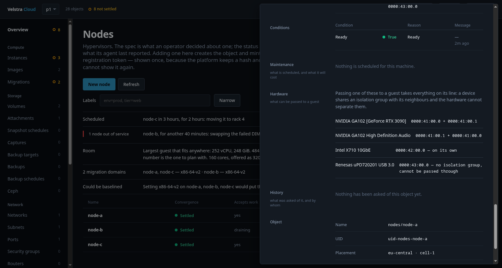

# Select a deployment model and PCI devices

## Choose the host model

| Model | Choose it when | Upgrade responsibility |
| --- | --- | --- |
| Sealed appliance | You control the entire node image | Stage an image on the inactive slot; inspect boot and update state |
| Debian package | Existing Debian hosts must retain their OS and tools | Update the Cloud package within the host's package lifecycle |
| NixOS modules | Host services are already managed declaratively | Rebuild the system from the matching module and package |
| OCI control plane | A scheduler already manages API and controller containers | Manage their lifecycle and persistent store separately |

For an installable artifact and first boot, see [Installation](install.md).

## Assess a PCI request

1. In **Nodes**, open the host's hardware inventory. Identify the requested function and every other device in its IOMMU group. Group assignment can affect devices used by the host.
2. Use the device class and an available assignable unit that meets the VM's requirements. The host needs IOMMU and the selected devices available for passthrough.
3. Request the device on a test instance. Check the placement report and the assigned hardware before scheduling a real workload.
4. Before draining the host, inspect the migration report. Treat a VM with a host-bound device as requiring explicit migration planning.



For a read-only cross-check on the host, match the PCI addresses in the console with:

```sh
lspci -Dnn
```

Binding a function to VFIO can remove it from host use. Confirm that neither boot storage nor an active management interface belongs to its group.

[Check CPU compatibility](cpu-heterogeneity.md) · [Review planned maintenance](operating.md#before-maintenance)

## Before binding a card

The appliance enables IOMMU through its boot configuration; on an existing host verify firmware and kernel support. The node's `VELSTRA_PASSTHROUGH` setting accepts PCI addresses or vendor/device pairs. A pair may select more than one matching card. Inspect every matching address and its entire isolation group before applying it. Keep an independent host access path while changing NIC or GPU bindings.

For a read-only view of the units the kernel can isolate together:

```sh
find /sys/kernel/iommu_groups -type l | sort
```

An empty list merits checking IOMMU configuration before offering a device class. A card bound to `vfio-pci` is unavailable to the normal host driver.
