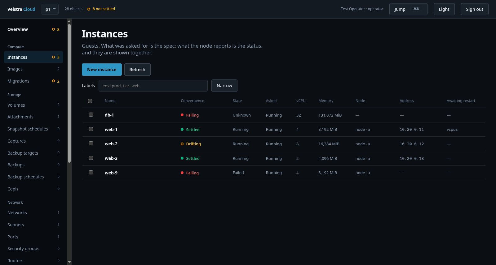

# Velstra Cloud documentation

Build a self-hosted cell for tenant VMs, volumes and networks. Each instance records both what you asked for and what its host observed. Use the placement report to find out why a request is waiting.

## Start with a working cell

[Run the development quickstart](quickstart.md) to compare a running instance with one that cannot fit anywhere. The two simulated hosts need no KVM device. To boot real guests, use the [installation guide](install.md).

## Choose a task

| Task | Start here |
| --- | --- |
| Install a node or control plane | [Installation options](install.md) |
| Add compute, storage or a second cell | [Set up a cell](setup-guide.md) · [Join a node](joining.md) |
| Diagnose a VM or plan maintenance | [Operator guide](operating.md) |
| Check processor compatibility before a move | [CPU compatibility](cpu-heterogeneity.md) |
| Move a guest whose root disk is local | [Local disk migration](local-disk-migration.md) |
| Restore the store or recover after host loss | [Recovery runbook](operations.md) |
| Update a group of nodes | [Release rollouts](upgrading.md) |
| Script against the cell | [CLI guide](cli.md) · [REST recipes](api-guide.md) |
| Look up wire semantics or generate a client | [REST contract](rest-contract.md) · [OpenAPI JSON](openapi.json) |
| Understand image packaging or allocate PCI hardware | [Deployment and devices](deployment-and-devices.md) |

