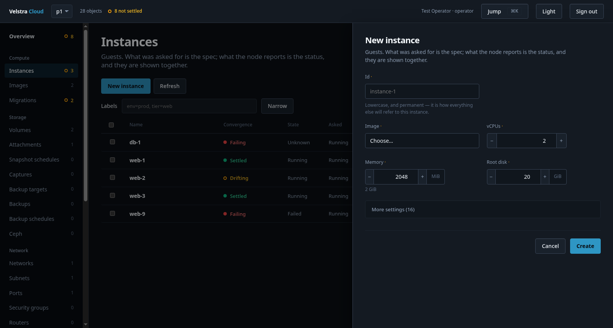

# Install Velstra Cloud

Choose the installation that matches the machine you have. Use the [development cell](quickstart.md) for evaluation without guest hardware.

| Target | Install | Persistent state |
| --- | --- | --- |
| Debian 13 / amd64 host | Cloud Debian package | Host files and etcd |
| Dedicated x86-64 node | Velstra installer ISO and sealed image | Data partition and cell store |
| Existing NixOS deployment | Control-plane, node and pool modules | As declared in the modules |
| Containerized control plane | API and controller OCI images | Shared etcd and release storage |

## Boot real guests on Debian

Use a dedicated Debian 13 host with hardware virtualization enabled and a matching package from the [release](https://github.com/Velstra/cloud/releases). Install QEMU **before** the quickstart so the wizard can select it. Run the following from the directory containing the downloaded package:

```sh
sudo apt install etcd-server qemu-system-x86 qemu-utils
sudo apt install ./velstra-cloud_*.deb
sudo velstra-cloud-node quickstart
```

The wizard provisions a single cell, creates its node and local pool, and starts its units. Record the console URL it prints and sign in with the administrator you created. The URL scheme depends on the TLS configuration. The development launcher's plain HTTP URL belongs only to that local example.

```sh
systemctl is-active velstra-cloud-api velstra-cloud-controller
systemctl status velstra-cloud-nodeagent --no-pager
```

In **Nodes**, verify that the host reports capacity. In **Pools**, verify that the pool reports its backend before creating a volume. For provisioning only the seed, run `velstra-cloud-node setup`; that command leaves startup to the operator.

## Install the sealed appliance

1. Download the ISO and corresponding checksums from one release. Verify the artifact against the checksum obtained from your trusted release source.
2. Boot the ISO on the target. Identify the target disk by model and capacity. Installing the image overwrites the selected disk.
3. Select **Start a cell** for the first node, or [join an existing cell](joining.md). Keep the registration material private.
4. After boot, verify that the node appears under the expected name and reports capacity.

To build the media from source:

```sh
nix build .#node-iso --out-link result-iso
nix build .#node-image --out-link result-image
```

## Use an existing control plane

Import the NixOS modules from the same Cloud revision as your package, or load the two OCI images:

```sh
nix build .#api-image --out-link result-api
nix build .#controller-image --out-link result-controller
docker load < result-api
docker load < result-controller
```

Configure both services against the same etcd cell. Supply API TLS credentials or terminate TLS at your ingress. The single-member bundled etcd setup has no quorum redundancy. See [Set up a cell](setup-guide.md) and [replicated control planes](operations.md#replicated-control-planes-and-release-storage).

## Add a guest

Register a cloud image using its publisher’s digest, create a project network and subnet, and create an instance with its image, size, port and SSH key. Compare the requested and observed states in the console. If the instance is running but unreachable, verify the guest port and the cell’s networking mode before retrying installation.



## Boot, encryption and service defaults

| Before deployment | What to account for |
| --- | --- |
| Appliance boot chain | The signed UKI carries the dm-verity root hash. Two store slots use boot counting. Secure Boot demonstration keys ship with the image; enroll keys you control for a fleet. |
| Writable data | The appliance root is volatile. Persistent seeds, etcd and service data belong on the writable partition under `/var/lib/velstra`. Optional LUKS2 encryption requires a working unlock procedure after power loss. |
| Remote management | Choose an SSH key or console login during install if needed. Validate access while an independent console is available. |
| API identity | Debian quickstart provisions a self-signed certificate and prints the fingerprint. Verify it through the host console or install a trusted PEM pair using `VELSTRA_TLS_CERT` and `VELSTRA_TLS_KEY`. Both are required for native TLS. |
| RBD-backed guests | Use QEMU built with RBD support. Cloud Hypervisor takes a disk path and cannot open the QEMU RBD backend. |
| Validation | `nix build .#checks.x86_64-linux.node-image-boots` exercises the image and `nix build .#checks.x86_64-linux.guest` boots an actual guest on a KVM-capable runner. |
