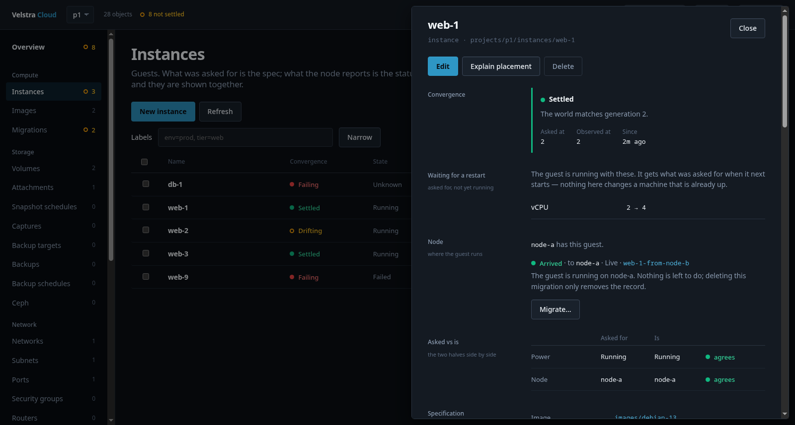

# Run a development cell

See a successful VM placement and a rejected request in the same console. The development cell runs the API and controllers in one process. Its hypervisors, disks and network are simulated. For a machine that boots guests, see [Install a real node](install.md).

## Start the cell

Use x86-64 Linux with Git and Nix. Enable the Nix `nix-command` and `flakes` features.

```sh
git clone https://github.com/Velstra/cloud.git
cd cloud
nix run .#dev
```

The first run fetches or builds the dependencies. Leave the process running. It prints the console URL, the development token and two host names. The default URL is `http://127.0.0.1:8080/`. If the port is busy, choose another one with `nix run .#dev -- 127.0.0.1:9090`.

## Inspect the seeded workload

1. Open the printed URL, sign in with the printed token and select project **p1**.
2. Open **Instances → web-1**. Compare the requested state with the observed state and the node assignment.
3. Open **too-big**. It requests 64 vCPUs and 256 GiB of memory. The larger default host offers 32 vCPUs and 128 GiB. The scheduler keeps the instance unassigned and records why.



## Read the same result over HTTP

In a second terminal, set the URL to the address printed by the launcher. Bash, curl and jq are used below.

```bash
export VELSTRA_API=http://127.0.0.1:8080
read -rs -p 'Development token: ' VELSTRA_TOKEN
printf '\n'
export VELSTRA_TOKEN
curl -fsS -H "Authorization: Bearer $VELSTRA_TOKEN" \
  "$VELSTRA_API/api/v1/projects/p1/instances/too-big:explainPlacement" \
  | jq '{placed, rejected}'
```

After both nodes have reported, `placed` is null and `rejected` includes named host decisions. See [Understand the rejection](operating.md#vm-placement) for the difference between this report and the last recorded condition.

Stop the launcher with **Ctrl+C**. Starting it again creates a fresh cell.
